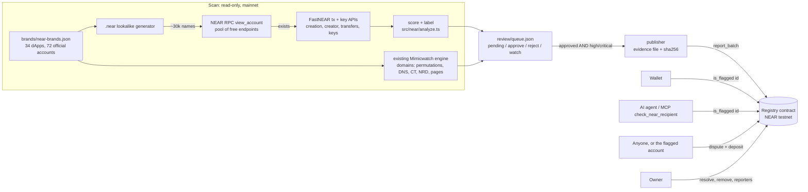

<p align="center"></p>

# Mimicwatch for NEAR: lookalike accounts and phishing domains, checked before you send

Scammers use names that look like NEAR projects: `linear_protocol.near` (a fake LiNEAR "rewards" token in 2,205
wallets) next to the real `linear-protocol.near`, or `rheaswap[.]finance` (a Rhea app clone that asks for seed phrases)
next to `rhea.finance`. A wallet's send screen and an AI agent cannot tell them apart. **Mimicwatch for NEAR** finds these lookalikes, has a person review them, and publishes the
confirmed ones to an **on-chain registry contract** that any wallet or agent can query with one view call before it
sends funds or opens a link.

1. **Scan.** It generates lookalikes of the official accounts of 34 NEAR dApps and checks which exist on mainnet
   (RPC `view_account`, read-only). For each one that exists it collects on-chain facts from free indexers: creation
   date and creator, keys, contract and token metadata, transfers in and out. It scores and labels them. Lookalike
   **domains** of the same dApps come from the existing Mimicwatch engine (permutations, DNS, certificate transparency,
   newly registered domains, page fingerprints, wallet blocklists).
2. **Review.** Findings go into a review queue (`review/queue.json`). Nothing is published until a person approves it.
3. **Publish.** Only approved **high** and **critical** findings are written to the registry, each with the sha256 of
   its evidence file. The contract itself refuses anything below high.
4. **Check before you send.** `is_flagged(id)` answers for an account, a domain or a URL, including sub-accounts of a
   flagged account and subdomains of a flagged domain. A small SDK, a CLI, a read-only HTTP API and an MCP tool
   (`check_near_recipient`) turn that into **ALLOW / WARN / BLOCK** with reasons.
5. **Dispute.** Anyone can dispute an entry on chain with a small deposit (the flagged account itself is recorded as
   such). While disputed, wallets warn instead of block. The owner keeps or clears the entry; clearing refunds the deposit.

NEAR HACKATHON 2026 entry, track `security` (AI Security & Defense: "reputation and scam detection"). Testnet only.

**Sibling project: [PurseStrings](https://github.com/kacpergumieniuk/pursestrings)**, a policy firewall for AI-agent
wallets on NEAR, by the same author. It is a separate, independent project and submission (rule Q-015): no shared code
and no dependency between them. PurseStrings limits what one agent's wallet may do; Mimicwatch finds impersonators across
the ecosystem and publishes a registry anyone can read.

**What the first scan found** (NEAR mainnet, 2026-11-01, read-only; [details](#findings-from-the-2026-11-01-scan)):

- **507** of 32,547 generated lookalike account names exist on mainnet.
- **A fake-airdrop campaign:** three NEP-141 tokens named after LiNEAR, Meta Pool and Burrow (`linear_protocol.near`,
  `metapools.near`, `burrowfinancedao.near`), each advertising a lookalike website in its token name, held by **2,205**,
  **9,434** and **7,079** accounts. `burrowfinancedao.near` created the other two.
- **A clone of the Rhea app** (`rheaswap[.]finance`, registered 2026-09-30) that asks for seed phrases and private keys,
  and was not on the MetaMask or ScamSniffer blocklists at scan time.
- **14 Rhea typosquat domains on one DNS account**, registered 2026-09-27 to 09-30. Most are already on MetaMask's list.
- **One creator registered 92 typo lookalikes** of 7 NEAR brands (`titiku.near`). Its key also controls 50+ other names.
- **False positives, labelled:** someone's own trading account hit by address poisoning, brands' defensive registrations,
  long-used personal names, a pet-loss community called Rainbow Bridge, and POTLOCK's own alternate domains.

**Nothing from the real scan is in the live registry yet.** Every real finding waits in
[`review/queue.json`](review/queue.json) as `pending`, with the agent's recommendation in its note, for the owner to
approve or reject. The live testnet registry holds only clearly marked synthetic test entries. The demo and the video
publish the real findings to a **local** NEAR node, using recorded review decisions.

## Try it (do X, see Y)

Prerequisites: Node 20.12+; for the contract, Rust with `wasm32-unknown-unknown` and [`cargo-near`](https://github.com/near/cargo-near).
No API keys, no accounts, no paid services.

```bash
npm ci
npm test                    # 134 TypeScript tests: 45 for the NEAR code + 89 of the pre-existing engine (network mocked)
npm run test:contract       # 39 contract unit tests + 1 end-to-end test on a local NEAR node (builds the wasm)
npm run demo                # the whole story, offline: recorded scan -> review -> local NEAR node -> agent checks
npm run demo -- --memory    # same story without the sandbox binary (in-memory registry with the contract's lookup rules)
```

What `npm run demo` shows, step by step (the same run is in the [video](#demo-video)):

| Step | You see |
|---|---|
| 1. Scan (recorded) | The recorded 2026-11-01 mainnet scan, re-scored offline: how many generated lookalikes exist, counts per label, the top findings |
| 2. Evidence | One finding with every fact it was scored on, and labelled false positives (brand-owned, someone's own trading account, address poisoning) |
| 3. Domains + review | Top lookalike domains; the review queue; the publisher lists what it will publish and **why everything else is skipped** (pending, rejected, severity medium, "not a threat" label) |
| 4. Publish | A local NEAR node starts, the registry is deployed, `report_batch` publishes the approved entries; the evidence file's sha256 equals the on-chain hash |
| 5. Check before you send | An agent asked to pay checks each recipient: a flagged lookalike → **BLOCK**, a sub-account of it → **BLOCK** (via parent), the official contract → **ALLOW**, an unlisted lookalike → **WARN**, a phishing link → **BLOCK** |
| 6. Dispute | A third party disputes an entry on chain → the same check turns into **WARN**; the owner keeps the entry → **BLOCK** again |

Read-only checks against the **live testnet registry** (no keys):

```bash
npm run check -- ref-flnance.near          # WARN: a lookalike of ref-finance.near that nobody has reviewed yet
npm run check -- v2.ref-finance.near       # ALLOW: official account of Rhea Finance
npm run check -- https://app.rhea-claim-test.example/connect   # a synthetic test entry and its subdomain
npm run check -- ref-flnance.mimicwatch-e7iig5g5.testnet          # BLOCK: synthetic test entry (our own account)
npm run check -- <id> --json               # machine-readable
npm run api                                # GET http://127.0.0.1:8787/check?id=ref-flnance.near
npm run mcp                                # MCP server (stdio) with the tool check_near_recipient
```

Run your own scan (mainnet, read-only; about 45 minutes for accounts at the free RPCs' pace, longer for domains):

```bash
npm run scan:accounts                      # -> data/scans/<date>/accounts-raw.json (recorded data) + accounts.json
npm run scan:accounts -- --brand rhea --no-typos   # one brand, fewer names (a few minutes)
npm run scan:domains -- --brand rhea       # -> data/scans/<date>/domains/<brand>/report.html + domains.json
npm run scan:accounts -- --rescore data/scans/2026-11-01/accounts-raw.json   # offline re-score
npm run review -- sync                     # add medium+ findings to review/queue.json as "pending"
npm run review -- list --decision pending
npm run review -- approve <subject> --reviewer <name> [--severity high] [--note "..."]
npm run review -- reject <subject> --reviewer <name> --note "why it is a false positive"
npm run publish:registry                   # dry run: what would be published, and why the rest is skipped
npm run publish:registry -- --send         # testnet only; signs report_batch as the reporter account
```

Deploy your own registry on testnet: `npm run build:contract && npm run testnet:setup` (one throwaway faucet account;
keys go to `.mimicwatch-local/testnet.json`, gitignored, mode 0600, never printed). Then `npm run testnet:demo` runs
every registry flow with synthetic entries (report, self-dispute, keep, third-party dispute, clear and refund).

## Live testnet deployment

| | |
|---|---|
| Registry contract | [`registry.mimicwatch-e7iig5g5.testnet`](https://testnet.nearblocks.io/address/registry.mimicwatch-e7iig5g5.testnet) |
| Owner | [`mimicwatch-e7iig5g5.testnet`](https://testnet.nearblocks.io/address/mimicwatch-e7iig5g5.testnet) (throwaway faucet account) |
| Approved reporter (the publisher signs as this account) | [`reporter.mimicwatch-e7iig5g5.testnet`](https://testnet.nearblocks.io/address/reporter.mimicwatch-e7iig5g5.testnet) |
| Code hash on chain | `ugLDXXVgTxz8x3hPWGoKK4KXUbWREoAfnEjzzpugm3B`, the sha256 (base58) of the wasm we built with `npm run build:contract` at commit `0fb9daa`; the contract has not changed since. The build is not reproducible across machines; `Cargo.toml` configures cargo-near's reproducible-build image |
| Deploy + `new` in one transaction | [`FHG5428…`](https://testnet.nearblocks.io/txns/FHG5428RjGgMYMMhYcFXd6Cdem2r51JGDg66Cg3KG9TL) |
| `add_reporter` | [`7mZQ7Hi…`](https://testnet.nearblocks.io/txns/7mZQ7Hi6C1CcgYGfM8oc2NvMg3pBbKq2uAjnkAGc4W65) |
| Synthetic test entries, `report_batch` | [`rjR1QgX…`](https://testnet.nearblocks.io/txns/rjR1QgXXRyBv3VGjfRWrtoaJ6m2y4ruWuTG42P3EcSz) |
| The flagged test account disputes itself (`by_subject: true`) | [`GMKNqTW…`](https://testnet.nearblocks.io/txns/GMKNqTW3pg5BHgX2Z3jM95R1kEc7eME2KasURRaPHZ4X) |
| Owner keeps the entry | [`A11PNQZ…`](https://testnet.nearblocks.io/txns/A11PNQZDN3Z3neY4vqVyd5CtyEYLEPt48sWrDU5ue7So) |
| A third party disputes the test domain | [`3bB8F4D…`](https://testnet.nearblocks.io/txns/3bB8F4DhHQeDEFjJkvaHhwrbnHPLejiokacfVVscQ93H) |
| Owner accepts: entry cleared, deposit refunded | [`2m3g6WC…`](https://testnet.nearblocks.io/txns/2m3g6WCcMichTrSBivUsxfeVz9bpMxW2gGPPrkLZGkgX) |

The test entries are `ref-flnance.mimicwatch-e7iig5g5.testnet` (our own account) and `rhea-claim-test.example` (a
reserved TLD); `npm run testnet:demo` creates them, and its log is in
[`docs/testnet-demo-output.txt`](docs/testnet-demo-output.txt). Real findings go on chain only after the owner's review
(`npm run publish:registry -- --send`).

Query it without this repo:

```bash
curl -s https://test.rpc.fastnear.com -H 'content-type: application/json' -d '{"jsonrpc":"2.0","id":1,"method":"query","params":{"request_type":"call_function","finality":"optimistic","account_id":"registry.mimicwatch-e7iig5g5.testnet","method_name":"stats","args_base64":"e30="}}' \
  | node -e 'let s="";process.stdin.on("data",d=>s+=d).on("end",()=>console.log(Buffer.from(JSON.parse(s).result.result).toString()))'
```


## Findings from the 2026-11-01 scan

Recorded data: [`data/scans/2026-11-01/`](data/scans/2026-11-01). It contains `accounts-raw.json` (every on-chain fact
collected), `accounts.json` (scored), `domains.json` (normalised domain findings) and one engine report per brand
(`domains/<brand>/report.html`, with screenshots of medium and higher findings). Domains are written defanged
(`[.]`); do not open them. These are **risk signals from public data, not accusations**. Each still needs the owner's
review.

**Scope:** 34 brands and 72 official accounts ([`brands/near-brands.json`](brands/near-brands.json); each account was
checked with `view_account` and tied to a primary source; see its `method` field). There were 30,026 generated names
plus 2,521 official sub-account names probed under lookalikes that exist. Lookalike domains were checked for 28 brands
(45,098 permutations, plus newly registered domains and blocklists).

### Accounts (507 exist)

| Label | Count | |
|---|---|---|
| `fake-token` | 3 | all critical, see below |
| `impersonation-likely` | 0 | no close copy showed contract, payment-collection or cluster evidence without also being old and busy |
| `lookalike-active` | 165 | 34 medium (close copies, active), 129 low, 2 info (locked) |
| `lookalike-dormant` | 314 | 5 medium (close copies that once moved money for others, e.g. `ref-flnance.near`), 110 low, 199 info |
| `brand-owned` | 4 | e.g. `sputnikdao.near` shares a key with `sputnik-dao.near`; `orderlynetwork.near` was created by `orderly-network.near` |
| `likely-unrelated` | 21 | e.g. `herewalletapp.near` (3,978 transactions since 2022), `meteor-wallet.near` |

| Finding | Severity | Evidence (abridged) |
|---|---|---|
| `linear_protocol.near` | critical, fake-token | Separator copy of `linear-protocol.near`. NEP-141 "$Linear Protocol Rewards (https://linearprotocol[.]net)", held by 2,205 accounts. Created 2024-05-18 by `burrowfinancedao.near`. |
| `metapools.near` | critical, fake-token | Copy of the Meta Pool name. NEP-141 "$Meta Pool Rewards (https://metapools[.]org)", held by 9,434 accounts. Created by `burrowfinancedao.near`. |
| `burrowfinancedao.near` | critical, fake-token | NEP-141 "Burrow Finance Rewards (https://burrowfi[.]com)", held by 7,079 accounts, including `contract.main.burrow.near`. Created 2024-05-16 by `nearrewards.near`. |
| `ref-flnance.near` | medium, dormant | Homoglyph of `ref-finance.near`. On 2024-02-08 it received 629 NEAR and sent 628.9 on within a minute. That fits a collection account, or the owner's own pass-through. Dormant since. |
| `nearprotocolreward.near`, `bl4ckdragon.near`, `circle_usdc.near` | medium | Lure-word or close copies created 1 to 40 days before the scan, with no activity yet. Watch. |
| `neta-pool.near` and 91 more | medium/low | All created by `titiku.near` (92 lookalikes across 7 brands, Nov 2025 to Feb 2026). Its key controls 50+ other names. A name collector. |
| `v2-ref-finance.near` | low (false positive) | Looks like the Rhea contract `v2.ref-finance.near`, but it is someone's trading account. The "senders" were 0.001 NEAR dust from lookalike implicit accounts: address poisoning aimed at its owner. |

### Domains (53 medium or higher, 38 of them high or critical, 30 of those already on a wallet blocklist)

| Finding | Severity | Evidence (abridged) |
|---|---|---|
| `rheaswap[.]finance` | critical | Copies the Rhea app's title, with a wallet-connect prompt, a **seed-phrase / private-key form** and "claim / airdrop / migration" lure text. Registered 2026-09-30 at Namecheap, hosted on GitHub Pages. **Not on MetaMask or ScamSniffer lists** at scan time. |
| `potlocktoken[.]org` | critical (agent: ask POTLOCK) | "Welcome to the Potlock!" token-eligibility page with wallet-connect and `eth_signTypedData_v4`. Registered 2025-09-05. Not on lists. |
| `nearmobile-rewards[.]app` | critical | Copies 70% of NEAR Mobile's text, with a claim/rewards lure. On MetaMask's list. |
| 14 Rhea typosquats (`rehea`, `rhe`, `rrhea`, `fhea`, `reha`, `apprhea` … `.finance`) | high | One Cloudflare DNS account, registered 2026-09-27 to 09-30, Rhea's title. On MetaMask's list. |
| `near-intents[.]net`, `near-intents[.]dev`, `app-metapool[.]xyz`, `orderlyreward[.]network`, `mnearwallet[.]com`, `rewards-rhea[.]xyz`, `near-rewards[.]com` … | high | Already on MetaMask's or ScamSniffer's list. |
| `wallet-meteorwallet[.]com` | medium (agent: raise to high) | Registered 2026-10-26, copies Meteor Wallet's title, mentions seed phrases, airdrop lure. |
| `sweatcoinhub[.]com`, `sweatcoincentral[.]com` | medium | Registered 2026-10-27 with copies of Sweatcoin's title. Watch. |
| `linearprotocol[.]io` | high (agent: ask LiNEAR) | Copies LiNEAR's title and 57% of its text, with wallet code. Could be an alternate LiNEAR domain. |
| `potlock[.]app`, `potlock[.]io`, `potlock[.]xyz` | high → **false positive** | They serve POTLOCK's own site and were registered with its other domains. Likely POTLOCK's. |
| `rainbowbridge[.]com`, `rainbowbridgeapp[.]com`, `rainbowbridge[.]co`, `rainbow-bridge[.]app`, `blackdragon[.]io`, `syncnear[.]com` | **false positives** | A pet-loss community, a pet memorial site, a music academy, a Slack connector, an unrelated business, a jobs site. |

The scanner fetched suspect pages only read-only. **Nothing was reported or filed anywhere.** Reporting the new ones
(`rheaswap[.]finance`, `potlocktoken[.]org` after a check, the fake tokens) to MetaMask, ScamSniffer and the affected
projects is the owner's decision.

## Demo video

[`docs/video/mimicwatch-demo.mp4`](docs/video/mimicwatch-demo.mp4) (1:54, 1080p, 8 MB, English voice-over and burned-in
subtitles, plus [`mimicwatch-demo.en.srt`](docs/video/mimicwatch-demo.en.srt)). It is `npm run demo` recorded
(`npm run demo:record` → [`mimicwatch-demo.cast`](docs/video/mimicwatch-demo.cast), [`viewer.html`](docs/video/viewer.html))
and rendered frame by frame (`npm run demo:render`): headless Chromium seeks the viewer, ffmpeg encodes. The voice is
synthetic (macOS `say -v Samantha`), one clip per subtitle line, and each line starts when its event appears on screen.
The registry in the video runs on a **local NEAR node**; the scan data is the recorded 2026-11-01 mainnet scan; the review
decisions are recorded demo decisions. Stills of each scene: [`docs/video/shots/`](docs/video/shots).

## Architecture



## The lookalike generator (`src/near/permute.ts`)

NEAR account ids are ASCII only (`a-z 0-9 - _ .`), so the Unicode homoglyphs that phishing domains use cannot exist on
NEAR. What can exist, and what the generator produces for each brand's name stems and official accounts:

| Trick | Example (for `ref-finance.near` / `v2.ref-finance.near`) |
|---|---|
| ASCII lookalike letters | `ref-flnance.near`, `ref-f1nance.near` (`l/1/i`, `o/0`, `rn/m`, `vv/w`, `cl/d`) |
| Digits for letters | `ref-financ3.near`, `r3f-finance.near` |
| Missing, doubled, swapped letters | `ref-fnance.near`, `ref-finnance.near`, `ref-fniance.near` |
| Keyboard typos, extra character, vowel swap | `ref-finamce.near`, `ref-finance1.near`, `ref-finence.near` |
| Separators | `reffinance.near`, `ref_finance.near`, `ref.finance.near` (a sub-account of `finance.near`) |
| Swapped words | `finance-ref.near` |
| Lure words | `ref-finance-support.near`, `ref-finance-claim.near`, `ref-finance-airdrop.near`, `claim-ref-finance.near` |
| Fake sub-accounts | `v2-ref-finance.near`, `v2ref-finance.near`, `token-sweat.near` (for `token.sweat`) |
| Brand + "near" | `ref-finance-near.near`, `near-ref-finance.near` |
| Other open top-level accounts | `ref-finance.tg` (HOT usernames) |
| Official sub-account names under a found lookalike | `v2.ref-flnance.near` (probed only when `ref-flnance.near` exists) |

The character-level typo fuzzers are reused from the existing engine's dnstwist-style generator; everything above that
is NEAR-specific was written in the hackathon. A brand's first two name stems get every trick; further stems get only
the close ones (lookalike letters, digits, separators). Official accounts and anything under an official root are never
proposed. Per run: 30,026 names for 34 brands.

## Signals, labels and severity (`src/near/analyze.ts`)

Scoring is a pure function of the recorded raw data (`accounts-raw.json`), so a recorded scan gives the same findings
every time. Ages are computed against the scan time, not the wall clock.

| Signal | Source (free, no key) | Meaning |
|---|---|---|
| Exists, balance, contract code hash | NEAR RPC `view_account` | `HAS_CONTRACT` when code is deployed |
| Keys | RPC `view_access_key_list` | `LOCKED`: no full-access key and no contract, so nobody can move funds out |
| Creation date and creator | FastNEAR transactions API (first transaction) | `NEW_ACCOUNT` (≤ 90 days), `RECENT_ACCOUNT` (≤ 1 year); creator = signer of the creation tx |
| Brand-owned | creator, or a full-access key shared with an official account (FastNEAR public-key API) | `BRAND_OWNED`: a defensive registration, never a threat |
| Token metadata | RPC `ft_metadata` on contracts | `FT_COPIES_BRAND`: a NEP-141 token using the brand's name or ticker |
| Money from others | FastNEAR transactions API, up to 30 transactions inspected | `RECEIVES_FROM_MANY` (≥ 3 distinct senders); transfers under 0.01 NEAR are **dust** (address poisoning aimed at the owner) and not counted |
| Pass-through | same | `FORWARDED_QUICKLY`: a transfer of ≥ 1 NEAR sent on (≥ 90%) within an hour |
| Same operator | public-key API | `SAME_OPERATOR`: shares a full-access key with other lookalikes in the scan; `KEY_CONTROLS_MANY`: the key controls 10+ other accounts (a name collector) |
| Activity | transactions API | `DORMANT`: no transaction for a year; `ESTABLISHED_HISTORY`: older than 2 years with 100+ transactions (likely someone's own name) |

| Label | When | Severity |
|---|---|---|
| `fake-token` | A contract whose `ft_metadata` uses the brand's name or ticker | critical if created within a year or paid by 2+ senders, else high |
| `impersonation-likely` | A close copy or lure-word name, active, and a contract, or money from 2+ senders, or a same-operator cluster, or created within 90 days | high; critical at score ≥ 75 |
| `lookalike-active` | Exists and active, no harm evidence | medium for close copies, low for typos |
| `lookalike-dormant` | No activity for a year | low; **medium** if it is a close copy that once collected money from others; info if locked |
| `brand-owned` | Created by, or shares a key with, an official account | info |
| `likely-unrelated` | A typo-distance name with a long unrelated history | low |

Only `critical`, `high` and `medium` enter the review queue. Only reviewed `high` and `critical` can be published.

## The registry contract (`contracts/registry`)

Rust, `near-sdk` 5.29. Storage is keyed by `<kind>:<subject>`, where kind is `account` or `domain`.

| Method | Who | What |
|---|---|---|
| `report(entry)`, `report_batch(entries ≤ 20)` | approved reporters, owner | Adds or updates an entry: `subject`, `kind`, `category` (`impersonation`, `phishing`, `drainer`, `fake-token`, `scam`), `severity` (**high or critical only**; lower is refused with `SEVERITY_TOO_LOW`), `evidence_url` (https/ipfs), `evidence_hash` (sha256 hex), `brand`, `note` (≤ 280). Validates account ids and domains; refuses top-level accounts. Re-reporting keeps the first-seen time and any open dispute. |
| `is_flagged(id)` | anyone (view) | `{query, flagged, via, entry, cleared}`. Accepts an account, a domain or a URL (reduced to its host). Matches the exact subject, then parents: a flagged account flags its sub-accounts (only the parent can create them), a flagged domain flags its subdomains. Never matches a bare top-level name. |
| `check_many(ids ≤ 50)`, `get_entry`, `list_entries(from, limit ≤ 100)`, `list_disputed`, `stats`, `get_cleared`, `list_reporters`, `is_reporter`, `get_owner`, `get_dispute_deposit` | anyone (view) | Listing and lookups |
| `dispute(subject, kind, reason)` | anyone, with ≥ 0.05 NEAR attached | One open dispute per entry. `by_subject` is true when the flagged account itself disputes. The entry stays visible with status `disputed`. |
| `resolve_dispute(subject, kind, keep, note)` | owner, 1 yoctoNEAR | `keep = true`: back to active, deposit kept, `disputes_rejected` + 1. `keep = false`: entry cleared, deposit refunded. |
| `remove(subject, kind, reason)` | owner, 1 yoctoNEAR | Deletes the entry and remembers the subject as **cleared**: reporters cannot re-add it (`SUBJECT_CLEARED`); only the owner can. Refunds an open dispute. |
| `unclear`, `add_reporter`, `remove_reporter`, `set_dispute_deposit`, `transfer_ownership` | owner, 1 yoctoNEAR | Administration. The 1 yoctoNEAR deposit proves a full-access key signed. |

Every change emits a NEP-297 event (`{"standard":"mimicwatch","version":"1.0.0","event":"entry_reported" | "entry_updated" | "entry_disputed" | "dispute_rejected" | "dispute_accepted" | "entry_removed" | "reporter_added" | "reporter_removed" | "owner_changed"}`), so indexers can follow the registry.

### Check before you send, in a wallet (no SDK)

```js
// One JSON-RPC view call. Works from a browser, a backend or an agent.
const res = await fetch("https://test.rpc.fastnear.com", {
  method: "POST", headers: { "content-type": "application/json" },
  body: JSON.stringify({ jsonrpc: "2.0", id: 1, method: "query", params: {
    request_type: "call_function", finality: "optimistic",
    account_id: "registry.mimicwatch-e7iig5g5.testnet", method_name: "is_flagged",
    args_base64: btoa(JSON.stringify({ id: recipient })) } }) });
const r = JSON.parse(new TextDecoder().decode(new Uint8Array((await res.json()).result.result)));
if (r.flagged && r.entry.status === "active") blockSend(r.entry);      // show r.entry.evidence_url
else if (r.flagged) askUser(r.entry);                                  // disputed
```

`src/sdk/check.ts` adds the brand list on top: official accounts and domains → ALLOW with the brand name; an unlisted
lookalike (confusable letters, one edit away from a long official name, a fake sub-account, or brand + lure word) →
WARN; registry unreachable → WARN (fail closed to a human).

## Tests

| Suite | Command | What it covers |
|---|---|---|
| Contract unit tests (39) | `cd contracts && cargo test --lib` | reporter auth, severity floor (medium/low refused), validation (account ids, top-level accounts, domains, https/ipfs evidence URLs, sha256 hashes, note length), normalisation (case, URL → host, ports, credentials), parent matching (sub-accounts, subdomains; similar names and bare top-level names never match; implicit accounts exact), re-reports keep first-seen time and open disputes, batch limit, disputes (deposit, one at a time, by-subject flag), owner keeps or clears (refund receipt), removal tombstones (reporters cannot re-add; owner can; `unclear`), 1-yoctoNEAR owner calls, ownership transfer, NEP-297 event shape |
| Sandbox end-to-end (1) | `cd contracts && cargo test --test sandbox` | the real wasm on a local node: unapproved reporter refused, owner approves reporter, medium refused on chain, high stored with event, `is_flagged` exact / sub-account / clean, `check_many`, the flagged account disputes itself with a deposit, a stranger cannot resolve, the owner clears it and the deposit is refunded to the account, a reporter cannot re-add it |
| NEAR code (45) | `npm test` (project `near`) | generator (valid ASCII ids only, every trick, short-stem limits, fake sub-accounts, probes, official names never proposed), scoring (impersonation-likely, fake-token, brand-owned by creator and by shared key, dust vs payments, pass-through, locked, unrelated history, same-operator, determinism), review queue (always pending, reviewer required, approval reset on changed evidence, rejections stick), publisher (pending / rejected / watched / medium / brand-owned / false-positive never published, reviewer severity override, evidence file sha256 = on-chain hash, idempotent, dry run, chunks of 20), check (BLOCK / WARN disputed / ALLOW official / WARN unlisted lookalikes / domains / fail closed when the registry is down), RPC pool (missing vs existing, 429 failover, unsupported-method errors are not "missing"), MCP tool over an in-memory transport, and the offline demo itself (same output twice, expected verdict sequence) |
| Pre-existing engine (89) | `npm test` (project `engine`) | the vendored engine's own suite, unchanged (network mocked) |


## What existed before vs what was built in the window (Q-001 to Q-005)

| | What | Where |
|---|---|---|
| **Baseline (pre-existing, not for judging)** | The Mimicwatch engine for EVM brands: domain permutations, DNS, certificate transparency, newly registered domains, page fingerprints and screenshots, wallet-blocklist status, scoring, RDAP abuse contacts, draft reports, and its vendored Canisell Base token engine. Written by the same author on 2026-11-01 in a separate private repo (`brandwatch`) for EVM projects. | `engine/` = the first commit, tagged **`pre-hackathon`**; see [`engine/PROVENANCE.md`](engine/PROVENANCE.md). Not modified since: `git diff pre-hackathon -- engine/` is empty. |
| **Built for NEAR in the window (judge this)** | Everything else: the NEAR brand list, the `.near` lookalike generator, the RPC pool and FastNEAR enrichment, account scoring, the domain-scan runner and normaliser for NEAR brands, the review queue, the publisher, the **registry contract** and its tests, the testnet deployment, the check-before-you-send SDK, CLI, HTTP API and MCP tool, the demo, the video pipeline, these docs. | `git diff pre-hackathon..HEAD` (once tagged: `pre-hackathon..hackathon-submission`). Repo: [compare view](https://github.com/kacpergumieniuk/mimicwatch-near/compare/pre-hackathon...main). |

- **Reuse of the engine, precisely:** the account generator imports the engine's character-level typo fuzzer (`labelFuzz`), the
  lookalike test imports its `levenshtein`, the RPC and indexer clients import its `sleep`/`politeSlot`/`mapLimit` helpers, and
  `npm run scan:domains` runs the engine CLI unchanged through `scripts/engine-run.ts` (which can short-circuit crt.sh when it is
  down). The domain findings are converted by `src/domains/normalize.ts`.
- **Libraries and tools:** `near-sdk` 5.29, `near-sandbox` and `near-api` (Rust tests), `cargo-near`; `near-api-js` v7,
  `near-sandbox` (npm), `@modelcontextprotocol/sdk`, `zod`, `tldts`, `playwright`, `viem` (engine only), `vitest`, `tsx`, `ffmpeg`
  and macOS `say` (video). Contract layout follows `cargo near new`.
- **AI-assisted:** written with Claude Code (Q-005).
- **Sibling project (Q-015):** [PurseStrings](https://github.com/kacpergumieniuk/pursestrings), a separate submission with its own
  code; neither project imports or calls the other.
- **Data sources:** free public endpoints only (NEAR mainnet RPCs, FastNEAR transactions and public-key APIs, crt.sh, WhoisDS,
  MetaMask and ScamSniffer public blocklists, RDAP). Suspect sites were only fetched read-only (HTTP GET and a headless render for
  screenshots); nothing was submitted to them, and nothing was reported to anyone.


## Known limitations

- **Signals, not proof.** Every label is a heuristic over public data. A lookalike name can belong to an innocent person
  (several did, see the false positives above). That is why nothing is published without a person's approval, why the
  contract has disputes and removal, and why the demo shows rejected findings.
- **Only names we generate.** The account scan finds lookalikes of the patterns in `src/near/permute.ts`; it cannot list all
  NEAR accounts containing a brand word (there is no free full-text account search). A scammer's `rhea-lucky-draw-2026.near`
  is missed until it shows up in a domain, a report or a transfer. The domain side adds certificate transparency and
  newly-registered-domain feeds, which are broader.
- **crt.sh was down during the 2026-11-01 domain scan**, so certificate-transparency search returned nothing in that run
  (every engine report says "incomplete scan"); domain findings come from permutations, newly registered domains and blocklists.
  Rerun `npm run scan:domains` when crt.sh answers.
- **Activity is sampled.** Transfers are read from the newest 30 transactions plus the creation transaction. Large accounts
  can hide older patterns.
- **One reviewer, one owner.** The registry has a single owner and an allowlist of reporters. A production registry would
  want several reviewers (a DAO or multisig as owner), reporter reputation, and expiring entries.
- **Testnet registry, mainnet subjects.** The contract runs on testnet for the hackathon; the subjects it lists are mainnet
  accounts and domains. Wallet integration would point at a mainnet deployment.
- **Public RPC limits.** The free RPCs rate-limit; a full 30k-name sweep takes about 45 minutes across a pool of 8 public
  endpoints. Existence answers are cached so an interrupted sweep resumes.
- **Evidence URLs** point at this GitHub repo, which is private until submission; they resolve once it is public.


## License

MIT, see [LICENSE](LICENSE). The vendored engine in `engine/` is by the same author and is released under the same license (see `engine/PROVENANCE.md`).
